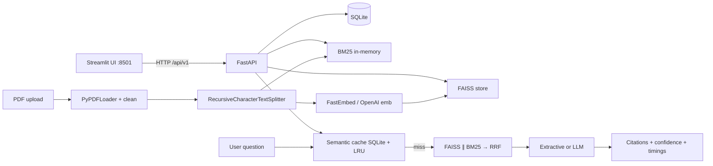

# DocuMind AI — Project Audit (Phase 1.1)

**Audit date:** 2026-11-12  
**Scope:** Read-only inspection of the repository as implemented. No retrieval, answering, or UI behaviour was changed in this phase before this document was written.  
**Tests run this session:** `pytest tests/unit` → **21 passed** (9.41s).  
**Existing eval run this session:** `python -m evals.run_eval --out evals/last_report.json` → completed; keyword_hit_rate **1.0** on 4 cases (proxy metric only; Recall@K/MRR unavailable).

---

## 1. Architecture as implemented



**Prose:** Streamlit (`streamlit_app/`) is the product UI. FastAPI (`backend/app/`) owns ingestion, hybrid retrieval, answering, history, admin stats, and health. Documents and chat live in SQLite (`data/chatbot.db`). Vectors live under `vector_store/` (FAISS + JSON metadata). BM25 is rebuilt in-process from the FAISS docstore. Default answering is offline extractive (`LLM_PROVIDER=extractive`); OpenAI / Azure / Anthropic are optional. Evaluation today is a small harness (`evals/run_eval.py` + `evals/dataset.json`) that reports keyword-hit proxy metrics, not gold Recall@K.

---

## 2. Feature table

| Feature | Status | Evidence |
|--------|--------|----------|
| PDF upload + stage timings | Works | `backend/app/services/document_service.py`, Documents UI |
| Page-aware chunking | Works | `backend/app/rag/ingest.py` |
| Local FastEmbed embeddings | Works | `config.embedding_provider=local`, `llm_factory.get_shared_embeddings` |
| FAISS semantic search | Works | `backend/app/rag/vector_store.py` |
| BM25 keyword search | Works | `backend/app/rag/hybrid_search.py` |
| Weighted RRF fusion | Works | `reciprocal_rank_fusion`, `hybrid_search_weight` |
| Parallel FAISS+BM25 | Works | `ThreadPoolExecutor` in `hybrid_search_detailed` |
| Document-scoped retrieval | Works | `document_ids` filter in hybrid search + chat API |
| Semantic cache + scope/mode key | Works | `semantic_cache._query_hash` includes scope + provider mode |
| Offline extractive answers | Works | `ExtractiveChatModel` in `llm_factory.py` |
| Optional cloud LLMs | Works | openai / azure_openai / anthropic branches |
| Citations (filename + page) | Works | `qa_chain.build_citations` |
| Greeting short-circuit | Works | `is_greeting` → no retrieval |
| Chat history + PDF export | Works | chat routes + `export_service` |
| Analytics (live latency/cache) | Works | admin stats + Analytics page |
| Honest `/health` UI | Works | sidebar Connected/Checking/Unavailable |
| Navy/teal Streamlit theme | Works | `styles/theme.py`, `.streamlit/config.toml` |
| Eval harness (proxy metrics) | Partial | `evals/run_eval.py` — no gold spans / Recall@K |
| Insufficient-evidence refusal | **Broken / weak** | Out-of-domain Qs still return high-confidence extractive answers (see §5) |
| Gold span evaluation | Missing | Needed for Phase 1.2+ |
| Cross-encoder reranker | Missing | Phase 3 |
| Citation validator / claim check | Missing | Phase 4 |
| PDF citation viewer highlight | Missing | Phase 5 |
| DOCX / OCR | Missing | Phase 6 |
| Docker Compose | Missing | Phase 6 |
| CI (Actions) | Missing | Phase 4 |
| Auth / multi-user | Out of scope | — |

---

## 3. Chunk IDs

**Creation:** In `ingest.split_documents`:

```text
chunk_id = f"{document_id}_{idx}"
```

where `idx` is the 0-based index after `RecursiveCharacterTextSplitter` (`chunk_size` / `chunk_overlap` from config, defaults 1000 / 200).

**Stability:** Chunk IDs **change** when chunking settings or extractable page text change, because `idx` boundaries move. Document UUID stays stable; page numbers are preserved in metadata (`page` 0-indexed from PyPDF → `page_number` 1-indexed).

**Implication for Phase 1+:** Gold labels must use `(filename, page, span)`, not `chunk_id`. Mapping spans → chunks at eval time is required (as specified).

SQLite `DocumentChunk.id` is set to the same `chunk_id` string (`document_service.save_and_index_pdf`).

---

## 4. Deletion behaviour today

`document_service.delete_document`:

1. `delete_document_vectors(document_id)` — removes FAISS vectors tracked in metadata `doc_chunk_ids`.
2. Deletes the PDF file from disk.
3. Deletes the SQLAlchemy `Document` row (chunks cascade via FK).
4. `rebuild_bm25_index()` — full BM25 rebuild from remaining FAISS docstore.
5. `clear_semantic_cache(session)` — **clears the entire semantic cache**, not only entries that referenced the deleted document.

**Assessment:** Vectors and BM25 are cleaned. Cache invalidation is correct but coarse (global wipe). Risk: concurrent chats lose all cache hits after any delete. Phase 6 asks for per-document cache purge — that is an improvement, not a current bug in grounding safety.

---

## 5. Current refusal behaviour (3 real examples)

Backend: extractive mode on `http://127.0.0.1:8001`, indexed local corpus (MediAssist / project PDFs). Ran 2026-11-12 this session.

| # | Question | Expected | Observed |
|---|----------|----------|----------|
| 1 | What is the capital of Mars colony Zeta-9? | not_found | **Answered** from unrelated MediAssist “CHAPTER 4 WEB APPLICATION MODULES”; `confidence=0.997`, 4 sources; served via `semantic_cache` (prior identical query). |
| 2 | What was Tesla's Q3 2019 revenue in USD? | not_found | **Answered** from unrelated mock/citation-coverage text; `confidence=0.997`, 4 sources, `hybrid_rrf`. |
| 3 | Who invented the DocuMind flux capacitor in 1847? | not_found | **Answered** from unrelated hallucination-survey prose; `confidence=0.946`, 4 sources, `hybrid_rrf`. |

**Root cause (as coded):**

- Hybrid search filters dense hits with `score >= 0.22` and keeps BM25 hits with `score > 0`, then always returns top-k fused chunks when any survive (`hybrid_search.py`).
- Extractive answerer ranks passages by crude term overlap and still emits “Answer from your documents” from the top passage even when overlap is weak (`llm_factory.ExtractiveChatModel`).
- `compute_confidence` normalizes RRF ranks so top results look strong even for irrelevant queries.
- Greetings correctly skip retrieval; true out-of-domain refusal does **not**.

This is the highest-severity product gap for portfolio credibility and is the target of Phase 2.

---

## 6. Bugs, duplication, risks (by severity)

| Sev | Issue | Notes |
|-----|--------|------|
| **P0** | Out-of-domain / near-miss questions get fluent extractive answers with high “confidence” | Confirmed live; Phase 2 |
| **P1** | Confidence labeled as retrieval strength in UI, but still numeric and easy to misread as correctness | UI already warns; rejection path needed |
| **P1** | Eval metrics are keyword proxies; cannot claim Recall@K/MRR | Phase 1.2 tooling |
| **P2** | Hardcoded dense threshold `0.22` in `hybrid_search.py` | Should move to config (Phase 2/engineering rule 4) |
| **P2** | Document delete clears **all** semantic cache | Safe but blunt; Phase 6 refinement |
| **P2** | `faiss_id` stored as `hash(fid) % 10**9` in SQLite — not the true FAISS id | Diagnostics/debug risk |
| **P3** | Duplicate API route registration patterns in `router.py` + documents router | Works; cleanup optional |
| **P3** | Streamlit on Windows can spawn dual Python processes for `:8501` | Ops annoyance, not logic bug |
| **P3** | Default `llm_provider` in Settings class is `"openai"` while `.env.example` prefers extractive | Env usually overrides; footgun for fresh configs |

**Duplication:** Legacy keyword eval in `evals/run_eval.py` vs new Phase 1.2 runner — keep both; do not replace until the new runner is proven.

---

## 7. Conflicts with later phases

| Later phase | Conflict / care needed |
|-------------|------------------------|
| Phase 2 multi-signal refusal | Must not break greeting short-circuit; cache key must include refusal/config version so old “Mars → wrong answer” cache entries are not reused |
| Phase 3 reranker | Optional + lazy; cache key must include reranker on/off; do not rewrite hybrid_search wholesale |
| Phase 3 chunking variants | Must use a **copy** of the corpus index — live user FAISS must stay untouched |
| Phase 4 citation validation | Extractive answers often lack quote-level spans; validator must allow extractive “passage lead” citations that map to evidence chunks |
| Phase 5 PDF viewer | Needs original PDF path + page; already stored on `Document.file_path` |
| Phase 6 metadata migration | Current chunks lack `file_type`, `extraction_method`, `parent_chunk_id` — requires migration |
| Phase 6 selective cache delete | Today only global clear exists |

---

## 8. Config & env (current)

Central settings: `backend/app/config.py` (Pydantic Settings + `.env`).

Notable RAG knobs already in config: `chunk_size`, `chunk_overlap`, `retriever_top_k`, `hybrid_search_weight`, semantic cache flags, upload size, embedding model.

**Not in config today (hardcoded):** dense FAISS floor `0.22`, RRF `k=60`, extractive overlap heuristics.

Ports: backend often **8001** when 8000 occupied; UI **8501**. Startup: `run_documind.bat` / `run_backend.bat` / `run_frontend.bat`.

---

## 9. Tests & eval snapshot

### Audit-time (before tooling)

```text
pytest tests/unit -q  →  21 passed
python -m evals.run_eval --out evals/last_report.json
  n_cases: 4
  keyword_hit_rate: 1.0   # proxy only
  Recall@K / MRR: unavailable
```

### Phase 1 complete (this session)

```text
pytest tests/unit -q  →  35 passed in 0.49s
evals/corpus/           →  10 PDFs (fixtures + local personal/report docs)
evals/data/questions.jsonl → 70 draft questions (unverified)
python -m evals.run --config default --split test
  → writes evals/results/<date>_default_test.json (retrieval scoring; draft labels)
```

No Phase 2 baseline was frozen. Headline Recall@K must not be claimed until
`label_source=human_verified` on the test split.

---

## 10. Closing note for Phase 1

This audit is the baseline for evaluation tooling and later phases. Retrieval/answering/UI
behaviour was not modified for Phase 1. Evaluation infrastructure (span map, metrics,
runner, draft questions, labeling guide) was added after this audit.
