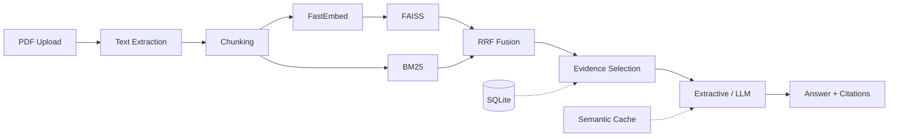

# DocuMind architecture

```
┌─────────────┐     ┌──────────────────────────────────────────┐
│  Streamlit  │────▶│  FastAPI  /api/v1                        │
│  :8501      │◀────│  chat · upload · history · admin         │
└─────────────┘     └───────────────┬──────────────────────────┘
                                    │
          ┌─────────────────────────┼─────────────────────────┐
          ▼                         ▼                         ▼
   ┌─────────────┐          ┌─────────────┐           ┌─────────────┐
   │  SQLite     │          │ Hybrid RAG  │           │ Semantic    │
   │  docs/chats │          │ FAISS∥BM25  │           │ cache       │
   └─────────────┘          │   → RRF     │           └─────────────┘
                            └──────┬──────┘
                                   ▼
                            Extractive / LLM
                                   ▼
                            Answer + citations + timings
```

Editable Mermaid (also shown under About → Mermaid source):



## Ingestion

1. Validate PDF magic bytes + size  
2. Extract pages (`PyPDFLoader`) with page numbers  
3. Chunk (`RecursiveCharacterTextSplitter`) with `document_id`, `filename`, `page_number`, `chunk_id`  
4. Embed once with shared FastEmbed instance → FAISS  
5. Rebuild BM25 from docstore  

## Query path

1. Cache lookup (hash includes document scope + LLM/embedding mode)  
2. Follow-up query expansion (lightweight, no extra LLM)  
3. Parallel FAISS + BM25 (thread pool)  
4. Weak-hit filter → RRF → dedupe → top-k  
5. Generate (extractive or provider) with grounded system prompt  
6. Record latency samples (no query text stored in metrics)

## Why hybrid RRF

Dense retrieval finds paraphrases; BM25 finds exact tokens (names, IDs). RRF combines ranks without requiring calibrated score fusion.
